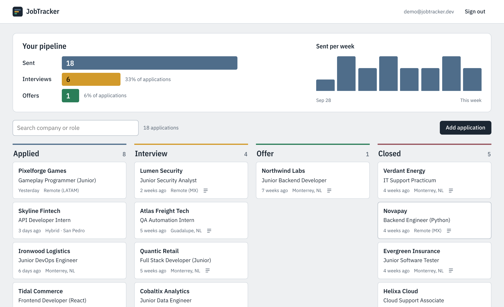
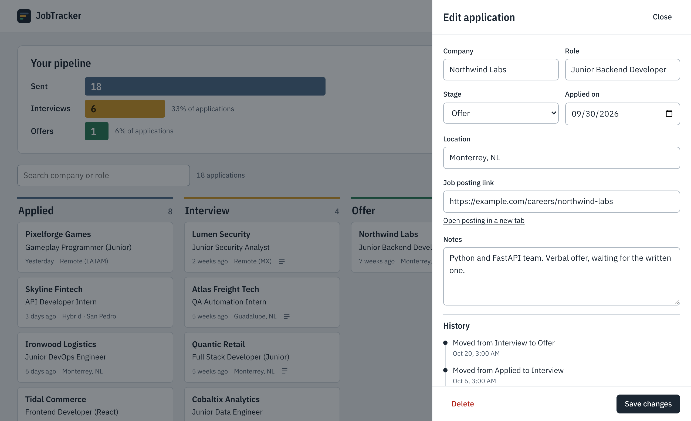
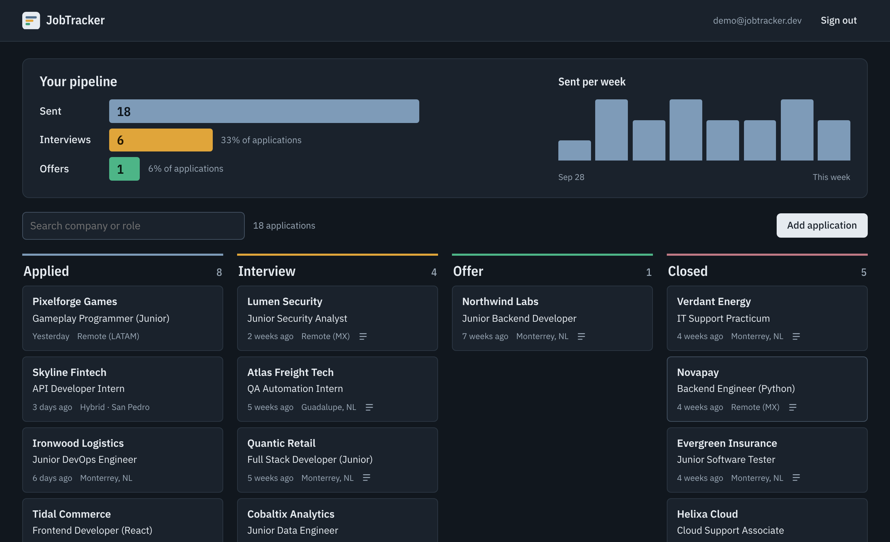
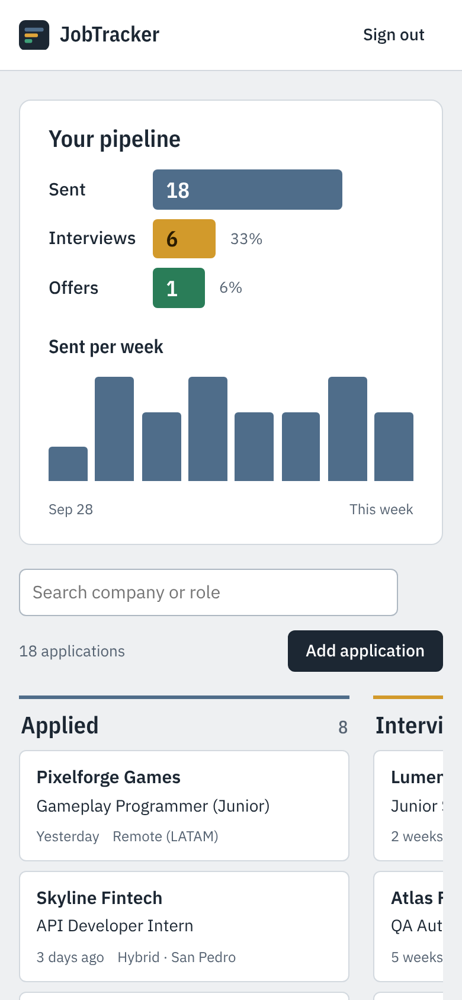

# JobTracker

A Kanban board for tracking job applications, with a status history and funnel statistics that show how many applications reach an interview and an offer.

Full-stack project: **FastAPI + PostgreSQL** API, **React + TypeScript** frontend, Docker, and a CI pipeline that enforces lint, types, security scans and tests.



<details>
<summary>More screenshots</summary>

| Edit view with history | Dark mode | Mobile |
|---|---|---|
|  |  |  |

</details>

Spanish summary: [README.es.md](README.es.md) · Code walkthrough in Spanish: [docs/es/guia-de-estudio.md](docs/es/guia-de-estudio.md)

## What it does

- Drag applications between **Applied → Interview → Offer / Closed**. Works with mouse, touch and keyboard (Space to pick up, arrows to choose a stage, Space to drop).
- Every move is recorded. The **pipeline** shows how many applications *ever* reached an interview or an offer, so an application that was rejected after an interview still counts as an interview.
- Dragged the wrong card? **Undo** from the toast. Reverting a move within two minutes erases it from the history, so a slip never distorts the numbers.
- Search by company or role, edit details and notes, open the job posting, see the full history of each application.
- Accounts with sign-up and sign-in; every user sees only their own data.
- Light and dark themes (follows the system), responsive down to phones.

## Tech stack

| Area | Choice |
|---|---|
| API | Python 3.12, FastAPI, Pydantic v2, SQLAlchemy 2.1 |
| Database | PostgreSQL 16 (SQLite for quick local runs), Alembic migrations |
| Auth | JWT (PyJWT), Argon2id password hashing, login rate limiting |
| Frontend | React 19, TypeScript (strict), Vite, TanStack Query, dnd-kit, plain CSS |
| Quality | pytest, Vitest, Ruff, mypy `--strict`, ESLint, Bandit, pip-audit, axe-core |
| Delivery | Docker, Docker Compose, nginx, GitHub Actions |

## Quick start

### With Docker (PostgreSQL + API + web)

```bash
cp .env.example .env        # then set POSTGRES_PASSWORD and SECRET_KEY
docker compose up --build
```

Open <http://localhost:8080>. API docs (Swagger): <http://localhost:8080/api/docs>.

To load a demo account with 18 sample applications:

```bash
docker compose exec api python -m scripts.seed
# demo@jobtracker.dev / demo-password-123
```

### Local development

```bash
# Backend (SQLite by default, no database to install)
cd backend
python -m venv .venv && source .venv/bin/activate
pip install -r requirements-dev.txt
alembic upgrade head
python -m scripts.seed          # optional demo data
uvicorn app.main:app --reload   # http://localhost:8000/api/docs

# Frontend (another terminal)
cd frontend
npm ci
VITE_DEMO_EMAIL=demo@jobtracker.dev VITE_DEMO_PASSWORD=demo-password-123 npm run dev
```

`make help` lists shortcuts for the common tasks.

## Quality gates

The CI workflow ([.github/workflows/ci.yml](.github/workflows/ci.yml)) runs on every push and pull request:

| Check | What it enforces |
|---|---|
| Ruff | Lint and formatting, including security rules (`S`) and bug-prone patterns (`B`) |
| mypy `--strict` | Full static typing of the backend |
| Bandit, pip-audit | Insecure code patterns and known-vulnerable dependencies |
| pytest on SQLite **and PostgreSQL** | The same suite on both databases; coverage must stay at or above 95% |
| `alembic check` | Migrations and models cannot drift apart |
| ESLint, `tsc --strict`, Vitest | Frontend lint, types and tests |
| `npm audit` | Known-vulnerable frontend dependencies (production) |
| Docker job | Builds the images, starts the whole stack and calls the health endpoint (written but not run yet: Docker was not available where this was built, so the first push is its first real run) |

Not in CI: accessibility was checked by hand with axe-core over every screen (sign-in, sign-up, board, both dialogs; light and dark; desktop and phone) and found no violations; the browser flows were driven with Playwright against a real PostgreSQL database. Those scripts are not part of the repository yet (see the roadmap). [docs/audit.md](docs/audit.md) lists what the audits found and how each finding was fixed.

## API overview

All routes live under `/api`. Interactive docs at `/api/docs`.

| Method | Route | Purpose |
|---|---|---|
| POST | `/auth/register` | Create an account |
| POST | `/auth/login` | Get an access token (OAuth2 password form) |
| GET / DELETE | `/auth/me` | Current user / delete the account and all its data |
| GET | `/applications` | List, with `status`, `q`, `limit`, `offset` |
| POST | `/applications` | Create |
| GET / PATCH / DELETE | `/applications/{id}` | Read, update (also moves between stages), delete |
| GET | `/applications/{id}/history` | Status changes, oldest first |
| GET | `/applications/stats` | Funnel numbers and applications per week |
| GET | `/health`, `/health/ready` | Liveness and readiness (checks the database) |

## Project layout

```
backend/
  app/
    main.py           app factory, CORS, error handlers
    config.py         typed settings from environment variables
    database.py       engine, sessions, SQLite foreign-key pragma
    models.py         User, Application, ApplicationEvent
    schemas.py        request/response validation (Pydantic)
    security.py       Argon2id hashing, JWT creation and checking
    dependencies.py   current user, database session
    ratelimit.py      login throttling
    routers/          thin HTTP layer: auth, applications, health
    services/         business rules: users, applications, stats
  alembic/            database migrations
  scripts/seed.py     demo data
  tests/
frontend/
  src/
    api/              fetch client, React Query hooks, types
    auth/             session context
    components/       Board, Column, Card, dialog, pipeline chart…
    lib/              pure helpers (stages, dates)
docs/                 architecture, decisions, audit, Spanish guide
```

How the pieces fit together: [docs/architecture.md](docs/architecture.md). Why they were built this way, including the trade-offs: [docs/decisions.md](docs/decisions.md).

## Security notes

- Passwords are hashed with **Argon2id** and upgraded automatically when parameters change. Login takes the same time whether or not the email exists.
- Access tokens expire (60 minutes by default) and are verified for signature and expiry. In production the API refuses to start without a `SECRET_KEY` of at least 32 characters.
- Every query is scoped to the signed-in user. Asking for someone else's application returns `404`, not `403`, so ids cannot be probed.
- Input is validated and normalised: length limits, `http(s)`-only links (no `javascript:`), no unknown fields.
- nginx sets a strict Content-Security-Policy, so only the app's own scripts, styles and fonts can run.
- Login and sign-up are rate limited per client address.

## Known limitations

Written down on purpose, so nobody has to find them:

- Sign-up is open and there is no email verification or password reset. Registering an address that already exists answers `409`, so sign-up reveals which emails have accounts; login does not. That is the usual trade-off for a clear error message; the fix is email verification, which needs a mail service.
- Tokens are not revoked before they expire and there are no refresh tokens. The token lives in `localStorage`; the CSP is the mitigation (see [decisions](docs/decisions.md#frontend)).
- The rate limiter keeps its counters in memory, so it is per process. Several API replicas would need a shared store such as Redis.
- Not yet deployed; there is no public demo link.

## Roadmap

- [ ] Deploy (Render or Fly.io) and add the live link here
- [ ] Commit the Playwright and axe-core scripts and run them in CI (today they were run by hand, outside the repository)
- [ ] Email reminders for applications with no news after N days
- [ ] CSV export

## License

[MIT](LICENSE)
