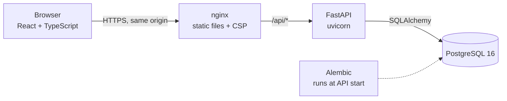
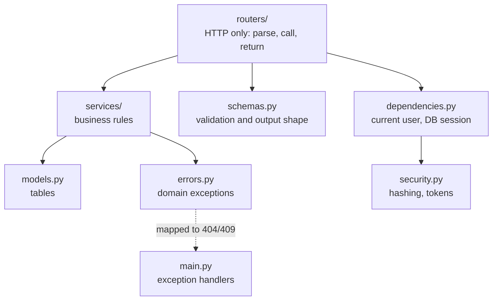
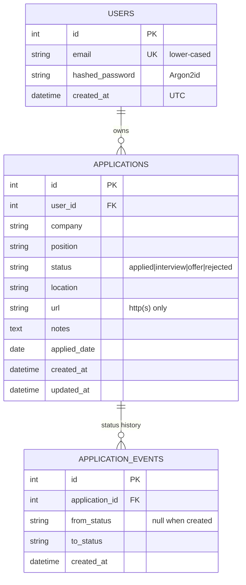
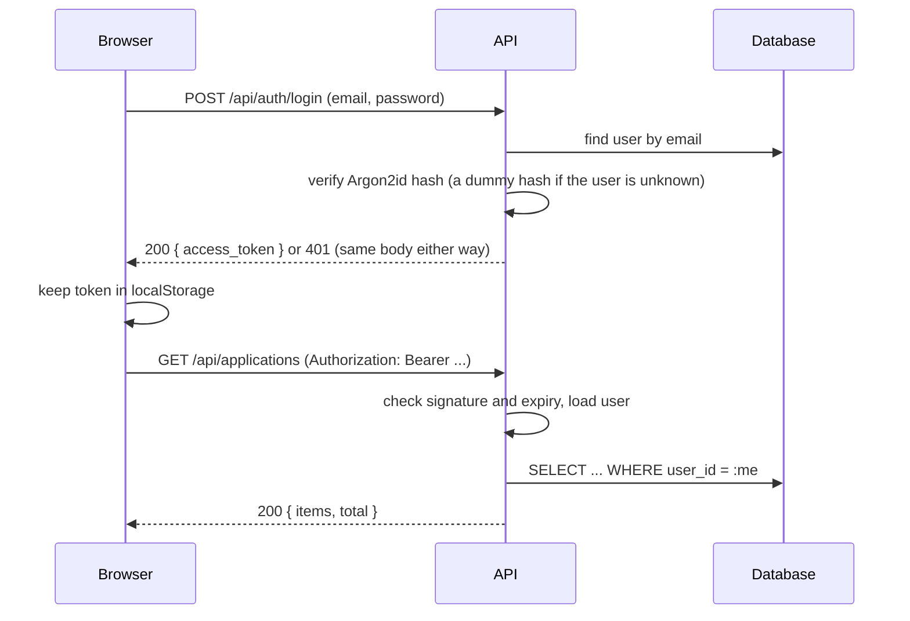
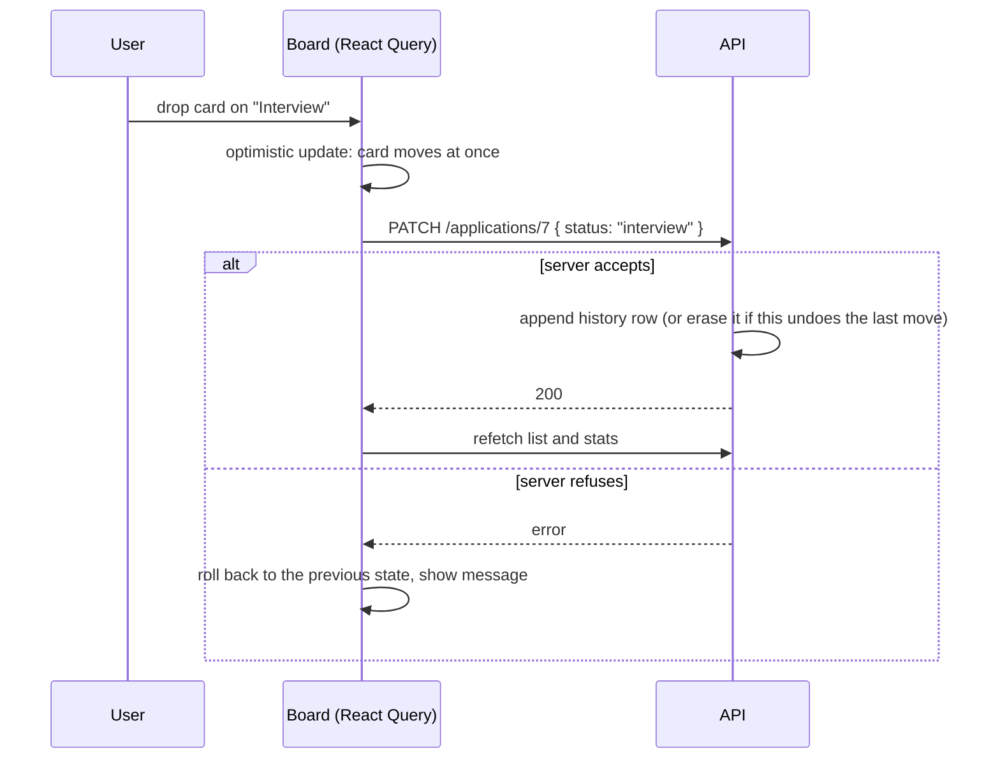

# Architecture

## System

The browser only ever talks to one origin. nginx serves the built frontend and forwards `/api` to the API container, which publishes no port of its own. In development, Vite's dev server plays nginx's role and proxies `/api` to `localhost:8000`.

## Backend layers

Each layer has one job:

- **Routers** know about HTTP (status codes, query parameters, response models) and nothing else. They hold no business logic.
- **Services** hold the rules (who may see what, how a status change is recorded, how stats are computed). They take plain arguments and raise domain exceptions, so they could be reused from a script, which `scripts/seed.py` does.
- **Schemas** are the contract with the outside world: they validate and normalise input, and shape output.
- **Models** describe tables and nothing more.

## Data model

Deleting a user deletes their applications, and deleting an application deletes its events. This is enforced by the database (`ON DELETE CASCADE`), not only by the ORM, and SQLite is told to enforce foreign keys so tests behave like production.

`status` is stored as `VARCHAR` with a `CHECK` constraint instead of a native PostgreSQL enum. Adding a stage later is then a one-line migration instead of an `ALTER TYPE`.

Indexes: `(user_id, status)` and `(user_id, applied_date)` on applications, because every query is scoped to the user and then filtered or sorted by one of those.

## Sign-in

## Moving a card

## Frontend structure

- `api/client.ts` is the only place that calls `fetch`. It adds the token, turns failures into one `ApiError` type and signs the user out on an expired session.
- `api/hooks.ts` wraps every operation in a React Query hook and owns the cache rules (what to refetch after a change, how to roll back an optimistic move).
- `auth/AuthContext.tsx` keeps the session. Everything below it renders either the sign-in screen or the workspace.
- `components/` are small and each does one thing. `Board` owns drag and drop; `Column` and `Card` are the drop target and the draggable; `ApplicationDialog` is the create/edit form with the history timeline; `PipelineStats` draws the funnel and the weekly chart.
- `lib/` has the pure functions (grouping, searching, date formatting). They are the easiest code to test, so they are kept free of React.

## Configuration

Everything comes from environment variables, read once into a typed `Settings` object (`app/config.py`).

| Variable | Default | Notes |
|---|---|---|
| `ENVIRONMENT` | `development` | `production` makes a weak `SECRET_KEY` a startup error |
| `DATABASE_URL` | `sqlite:///./jobtracker.db` | Use `postgresql+psycopg://…` in production |
| `SECRET_KEY` | random per process | Required (32+ characters) in production |
| `ACCESS_TOKEN_MINUTES` | `60` | |
| `CORS_ORIGINS` | `http://localhost:5173` | Comma-separated |
| `RATE_LIMIT_ENABLED` | `true` | Tests turn it off |
| `AUTH_RATE_LIMIT` | `10/minute` | Applies to login and sign-up |
